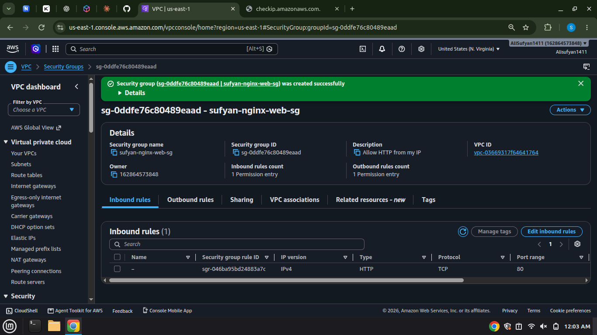
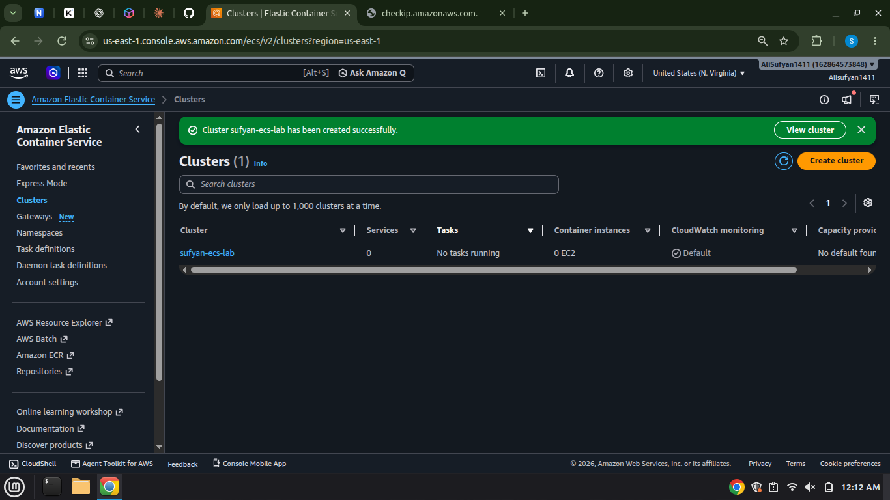
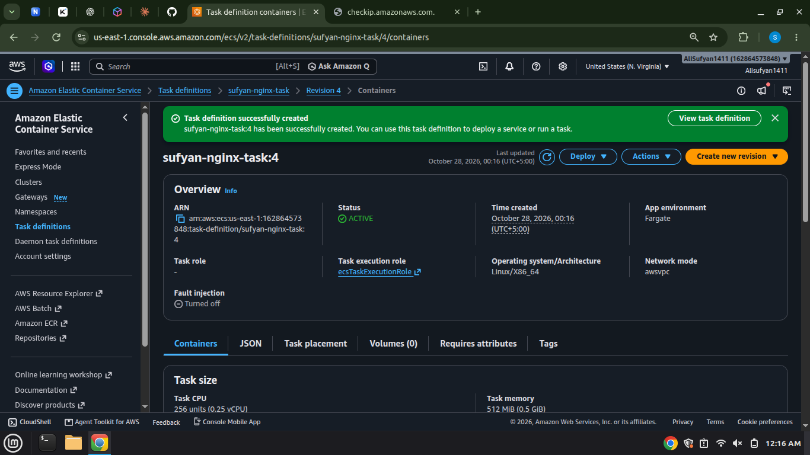
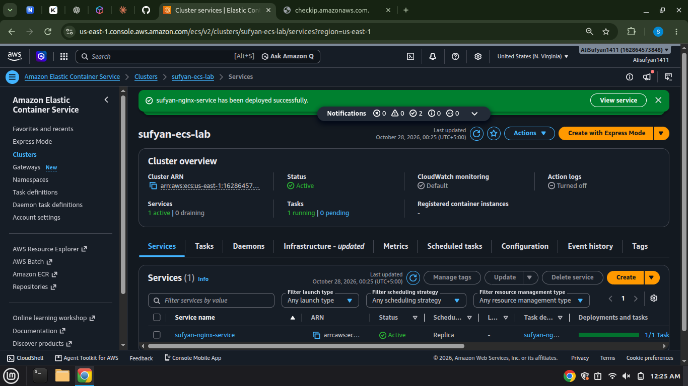
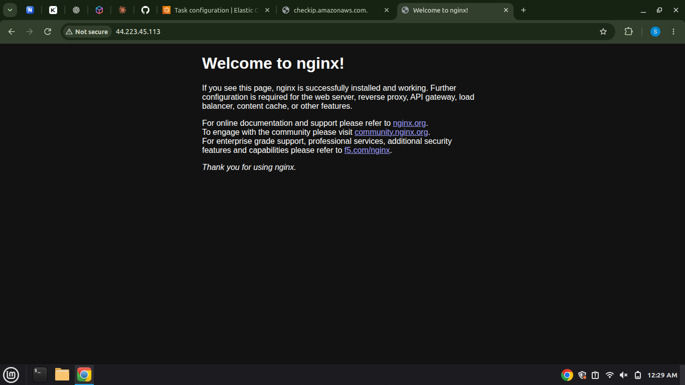
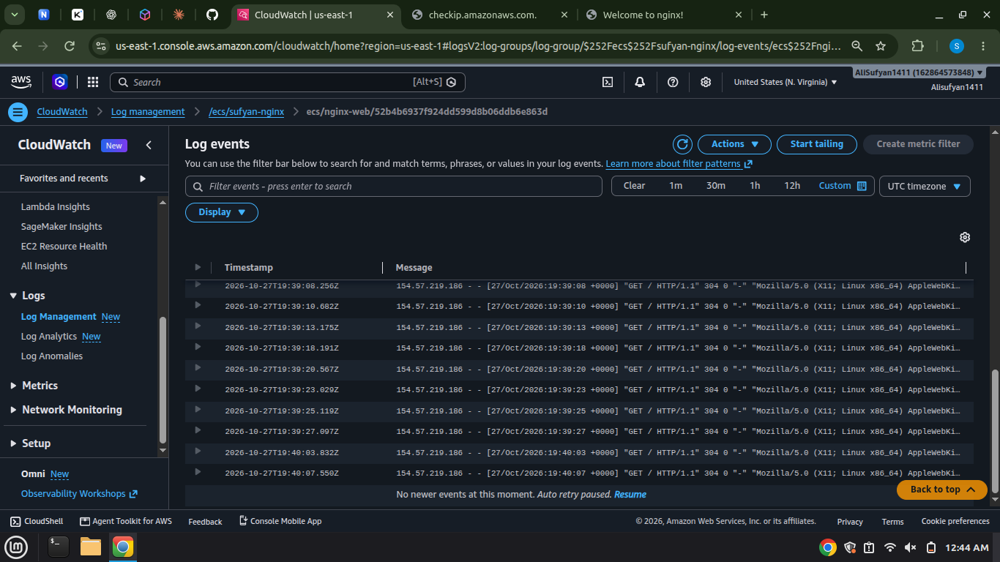
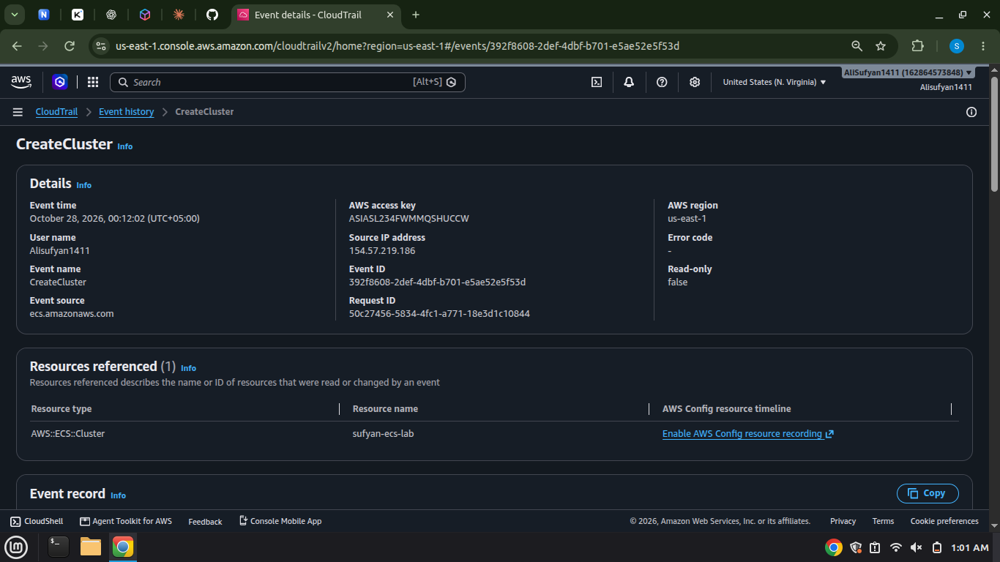

# Deploying Nginx on AWS ECS Fargate with CloudWatch Logs and CloudTrail

A hands-on cloud lab where I ran an **Nginx web server as a container on Amazon ECS with AWS Fargate**, opened it in a browser, monitored it with **CloudWatch Logs**, and audited the AWS activity with **CloudTrail**, all without managing a single server.

---

## Table of Contents
1. [Project Goal](#project-goal)
2. [Architecture](#architecture)
3. [AWS Services Used](#aws-services-used)
4. [Resources Created](#resources-created)
5. [Step-by-Step Implementation](#step-by-step-implementation)
6. [Verification](#verification)
7. [Troubleshooting: What I Learned](#troubleshooting-what-i-learned)
8. [CloudWatch vs CloudTrail](#cloudwatch-vs-cloudtrail)
9. [Where Nginx Stores Its Files](#where-nginx-stores-its-files)
10. [Cleanup](#cleanup)
11. [Key Takeaways](#key-takeaways)

---

## Project Goal

- Run an Nginx web server using **ECS Fargate** (serverless containers).
- Restrict access to my own IP address using a **security group**.
- Open the web server in a browser.
- Collect container logs in **CloudWatch Logs**.
- Inspect AWS API activity in **CloudTrail**.

## Architecture

```
 Browser (my public IP /32)
        │  HTTP :80
        ▼
 Security Group  (sufyan-nginx-web-sg)
        │
        ▼
 ECS Fargate Task  ──►  Nginx container (nginx:alpine)
 (public subnet,                │
  public IP on)                 │ stdout / stderr (awslogs driver)
                                ▼
                       CloudWatch Logs  (/ecs/sufyan-nginx)

 Every AWS API call (CreateCluster, CreateService, ...) ──► CloudTrail Event history
```

## AWS Services Used

| Service | Role in this lab |
|---|---|
| **Amazon ECS** | Orchestrates the container (cluster, task definition, service) |
| **AWS Fargate** | Runs the container without managing EC2 servers |
| **Amazon VPC / Security Groups** | Acts as a firewall allowing HTTP only from my IP |
| **Amazon CloudWatch Logs** | Stores the Nginx access and error logs |
| **AWS CloudTrail** | Records who did what to my AWS resources |
| **IAM (ecsTaskExecutionRole)** | Lets ECS pull the image and write logs |

## Resources Created

| Resource | Name |
|---|---|
| Region | US East (N. Virginia), `us-east-1` |
| Security group | `sufyan-nginx-web-sg` |
| ECS cluster | `sufyan-ecs-lab` |
| Task definition | `sufyan-nginx-task` |
| Container | `nginx-web` (image `nginx:alpine`, port 80) |
| Log group | `/ecs/sufyan-nginx` |
| ECS service | `sufyan-nginx-service` (1 desired task) |

---

## Step-by-Step Implementation

### Step 1: Select the Region
I set the AWS Console Region to **us-east-1**.

**Why:** AWS resources are regional. Everything in this lab must live in the same Region so the components can work together.

### Step 2: Find my public IP
I opened `checkip.amazonaws.com` to get my IPv4 address.

**Why:** I use this address to allow access to the web server from my own network only, instead of exposing it to the whole internet.

### Step 3: Create the security group
In **VPC → Security Groups**, I created `sufyan-nginx-web-sg` in the default VPC with one inbound rule:

| Type | Protocol | Port | Source |
|---|---|---|---|
| HTTP | TCP | 80 | `<my-public-ip>/32` |



**Why:** A security group is a stateful firewall. Port 80 lets the browser reach Nginx over HTTP, and `/32` limits access to exactly one IPv4 address.

### Step 4: Create the ECS cluster
In **Amazon ECS → Clusters**, I created `sufyan-ecs-lab` using the default Fargate infrastructure.



**Why:** A cluster is the logical grouping where ECS organizes services and running tasks. With Fargate there are no EC2 instances to provision or patch.

### Step 5: Create the task definition
I created the task definition `sufyan-nginx-task` with:

| Setting | Value |
|---|---|
| Launch type | AWS Fargate |
| OS / Architecture | Linux / X86_64 |
| Network mode | awsvpc |
| CPU / Memory | 0.25 vCPU / 0.5 GiB |
| Task execution role | `ecsTaskExecutionRole` |
| Container name | `nginx-web` |
| Image URI | `nginx:alpine` |
| Container port | 80 (TCP) |

**Why:** The task definition is the blueprint ECS follows: which image to run, how much CPU and memory to give it, and which port it uses. The `awsvpc` mode gives the task its own network interface, so the security group applies directly to it.

### Step 6: Configure CloudWatch Logs
In the container's log collection settings (destination **Amazon CloudWatch**, which uses the `awslogs` driver):

| Key | Value |
|---|---|
| `awslogs-group` | `/ecs/sufyan-nginx` |
| `awslogs-region` | `us-east-1` |
| `awslogs-stream-prefix` | `ecs` |
| `awslogs-create-group` | `true` |



**Why:** The Nginx image writes access logs to stdout and error logs to stderr. The `awslogs` driver forwards those streams to CloudWatch, so I can inspect web requests without logging into a server.

### Step 7: Create the ECS service
Inside the cluster, I created `sufyan-nginx-service` with:

| Setting | Value |
|---|---|
| Launch type | Fargate |
| Task definition | `sufyan-nginx-task` (latest revision) |
| Desired tasks | 1 |
| Subnet | Public subnet |
| Auto-assign public IP | On |
| Security group | `sufyan-nginx-web-sg` (default group removed) |
| Load balancer | None |



**Why:** A service keeps the desired number of tasks running and replaces them if they fail. A public subnet plus a public IP allows direct browser access in this lab.

---

## Verification

### Step 8: Open the Nginx website
I copied the task's public IP and opened `http://<public-ip>/` in the browser. The Nginx welcome page loaded.



**How it works:** The browser sends an HTTP request to the task's public IP on port 80. The security group allows it because my IP matches the `/32` rule, Nginx receives the request, and it returns the welcome-page HTML.

### Step 9: View the logs in CloudWatch
I refreshed the page several times, then opened **CloudWatch → Log Management → Log groups → `/ecs/sufyan-nginx`** and the newest log stream. Each refresh appears as an access-log entry (`GET / HTTP/1.1`).



**Why:** Every refresh creates an HTTP request. Nginx writes an access-log line, and the `awslogs` driver ships it to CloudWatch Logs.

### Step 10: Inspect AWS activity in CloudTrail
In **CloudTrail → Event history** (us-east-1), I searched for the events `CreateCluster`, `RegisterTaskDefinition`, and `CreateService`, and opened them to see which identity made each call, when, and from where.

<!-- Add your CloudTrail screenshot below, or delete this section if you do not include one -->


**Why:** CloudTrail records AWS API activity, which gives an audit trail of who created or changed which resource.

---

## Troubleshooting: What I Learned

My first attempt did not load the page, and debugging it taught me the most:

1. **Wrong URL:** I typed the lab's `PUBLIC-IP` placeholder literally, so Chrome treated it as a hostname (`DNS_PROBE_FINISHED_NXDOMAIN`). The fix was to use `http://<actual-ip>/`.
2. **Connection timeout:** `ERR_CONNECTION_TIMED_OUT` means packets are dropped before reaching the server. That points at the network path, not the application.
3. **Using CloudWatch to isolate the problem:** the log stream showed Nginx starting cleanly (`ready for start up`, `start worker processes`) but **no `GET /` lines**. That proved the container was healthy and my requests were never arriving, so the problem was in front of it, in the security group.
4. **Checklist that fixes it:**
   - The task must show **Running**.
   - The task's networking must show my custom security group, **not** `default`.
   - The inbound rule must match my **current** public IP with `/32`.
   - Public IP must be enabled on the service.
   - Use `http://`, not `https://`.

Lesson: **logs tell you where the problem is not.** Healthy startup logs with no request logs means look at networking.

## CloudWatch vs CloudTrail

| | CloudWatch Logs | CloudTrail |
|---|---|---|
| Shows | What happens **inside** the application | What happens **to AWS resources** (API calls) |
| Example | `GET / HTTP/1.1` 200 from my browser | `CreateService` by my IAM user |
| Question it answers | "What is my container doing?" | "Who did what, and when?" |

## Where Nginx Stores Its Files

These paths exist inside the container:

| Path | Purpose |
|---|---|
| `/etc/nginx/nginx.conf` | Main Nginx configuration |
| `/etc/nginx/conf.d/default.conf` | Default server configuration |
| `/usr/share/nginx/html/` | Website directory |
| `/usr/share/nginx/html/index.html` | Default welcome page |

## Cleanup

To avoid unnecessary charges, I removed everything in this order:

1. Deleted the service `sufyan-nginx-service`.
2. Deleted the cluster `sufyan-ecs-lab` after its tasks were gone.
3. Deregistered the `sufyan-nginx-task` revisions.
4. Deleted the security group `sufyan-nginx-web-sg`.
5. Deleted the log group `/ecs/sufyan-nginx`.

## Key Takeaways

- Fargate runs containers without managing servers.
- A security group with a `/32` rule is a simple way to limit exposure of a lab server.
- The task definition is the blueprint, the service keeps it running, and the cluster groups it.
- CloudWatch Logs explains application behavior; CloudTrail explains AWS account activity.
- Always clean up resources to avoid surprise bills.

---

*Built as part of an AWS ECS Fargate hands-on lab.*
